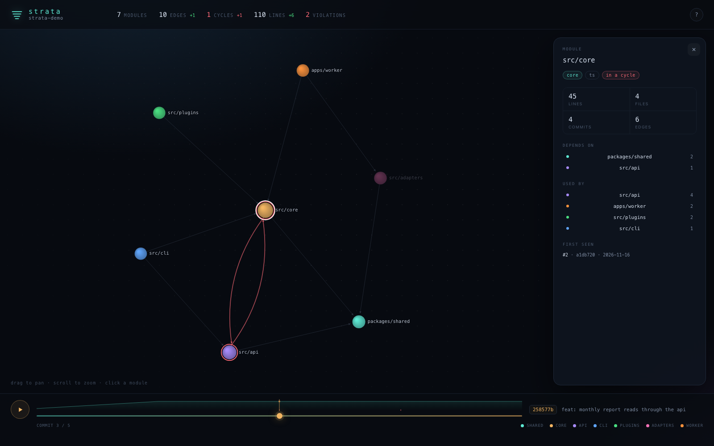
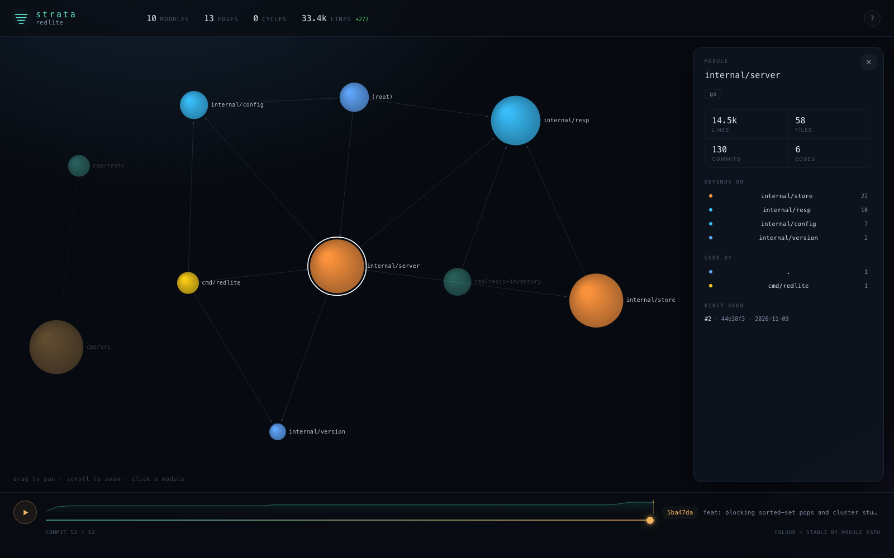

# strata

**The architecture time machine for git repositories.**

[](https://github.com/BViganotti/strata/actions/workflows/ci.yml)

`strata` replays a repository's history, rebuilds the module dependency graph at
every commit, and lets you scrub through the result in a local web UI. Cycles,
new modules, and layer violations appear on the commit that introduced them.

A CI mode fails a pull request only when it makes the architecture *worse* than
a baseline, so legacy coupling does not block the team on day one.



## Why

Dependency tools answer "what does the graph look like now?" Architecture
reviews happen in snapshots, usually in a slide deck that is stale by Thursday.
Nobody can answer the question that actually matters during a refactor: *when
did this edge appear, and what did the last six months do to the shape of this
codebase?*

`strata` treats the architecture as a time series:

- every commit is a frame, not a report;
- a new cycle is attributed to the commit that created it;
- a layer rule is checked against each frame, and the ratchet only fails on
  **new** violations relative to a baseline;
- the graph diff between any two revisions is a first-class command.

The UI is embedded in a single binary. No accounts, no services, no telemetry.

## Who it is for

Maintainers of long-lived repositories — especially ones that grew a second
language, a plugin system, or a port — who want to see coupling creep in before
it turns into a rewrite. It is equally useful for a one-off archaeology session:
"why does `api` import `core` and `core` import `api`?"

## Quick start

Requirements: a C++17 compiler, CMake 3.16+, `git`, and the SQLite 3
development headers.

```console
# Debian / Ubuntu
sudo apt install build-essential cmake libsqlite3-dev
# Fedora
sudo dnf install gcc-c++ cmake sqlite-devel
# macOS: the SDK already ships libsqlite3
xcode-select --install
```

Build and run the bundled demo:

```console
$ cmake -S . -B build -DCMAKE_BUILD_TYPE=Release
$ cmake --build build -j

$ ./examples/demo/make-demo-repo.sh /tmp/strata-demo
$ ./build/strata ingest /tmp/strata-demo --db /tmp/strata-demo.db
$ ./build/strata serve --db /tmp/strata-demo.db
serving http://127.0.0.1:7777
```

Open <http://127.0.0.1:7777> and scrub to commit **3 / 5**. The demo repository
starts as a monolith, splits into layers, introduces a `core -> api` cycle, and
then fixes it. Press <kbd>space</kbd> to play the history.

Point it at your own repository:

```console
$ ./build/strata ingest . --limit 200
$ ./build/strata serve
```

`--limit` samples the first-parent history evenly; omit it to ingest every
commit. Ingest is incremental in the sense that re-running it replaces that
repository's snapshots; a true incremental cache is on the [roadmap](ROADMAP.md).

### On a real repository

`redlite` is a Redis-compatible server with a C++ port. The port appears at
commit 49 as a separate cluster, which is exactly the kind of change a snapshot
tool hides:



## The ratchet

This is the part that keeps an architecture from silently eroding. It compares
two revisions and exits non-zero only for regressions that are new relative to
the baseline:

```console
$ strata check --baseline origin/main
baseline  origin/main  d4e5f6a
target    HEAD         a1b2c3d

cycles      0 -> 1
violations  0 -> 2

new regressions:
  x cycle: src/api -> src/core -> src/api
  x src/core (core) -> src/api (api): core may not depend on api

2 new architectural regression(s)
$ echo $?
1
```

Use it in CI with a full clone so the baseline commit is available:

```yaml
name: architecture
on: pull_request

jobs:
  strata:
    runs-on: ubuntu-latest
    steps:
      - uses: actions/checkout@v4
        with:
          fetch-depth: 0
      - run: sudo apt-get install -y libsqlite3-dev
      - run: cmake -S . -B build -DCMAKE_BUILD_TYPE=Release && cmake --build build -j
      - run: git fetch origin ${{ github.base_ref }}
      - run: ./build/strata check --baseline origin/${{ github.base_ref }}
```

Output formats: `--format text` (default), `json`, or `markdown` (handy as a
pull request comment). Exit codes: `0` clean, `1` new regressions, `2` usage or
git error.

`strata diff v1.0.0 HEAD` prints the raw architectural delta — modules and
dependencies added or removed, line-count changes, and the cycle count.

## Configuration

Layer rules live in `.strata.json` at the repository root. It is parsed as
JSONC, so comments are allowed.

```jsonc
{
  "layers": [
    {"name": "shared", "paths": ["packages/shared/**"]},
    {"name": "core",   "paths": ["src/core/**"]},
    {"name": "api",    "paths": ["src/api/**"]},
    {"name": "cli",    "paths": ["src/cli/**"]}
  ],
  "allow": {
    "shared": [],
    "core": ["shared"],
    "api": ["core", "shared"],
    "cli": ["core", "api", "shared"]
  },
  "ignore": ["**/*.test.ts", "generated/**"],
  "max_cycles": 0
}
```

- `layers` are evaluated in order; the first matching pattern wins. A layer
  pattern ending in `/**` also matches the module directory itself.
- `allow` is an allow-list per layer. A layer with no entry may not depend on
  anything; same-layer dependencies are always allowed. `"*"` permits all
  layers.
- Any edge between two *different* layers that is not allowed is a violation.
- `ignore` adds globs on top of the defaults (`vendor/`, `node_modules/`,
  `third_party/`, `dist/`, `build/`, `target/`, `.git/`, `.strata/`).
- `max_cycles` is an optional absolute gate; `-1` (the default) disables it.

Without a config file, only cycles are checked. That is a deliberate default:
it works on any repository with zero setup.

## Commands

| Command | What it does |
| --- | --- |
| `strata ingest [path]` | Rebuild the snapshot database from git history. Flags: `--db`, `--limit`, `--stride`, `--since`, `--name`. |
| `strata serve` | Serve the embedded UI and JSON API. Flags: `--db`, `--addr`, `--web-dir`. |
| `strata check` | Ratchet a revision against a baseline. Flags: `--repo`, `--baseline`, `--target`, `--format`. |
| `strata diff FROM TO` | Print or emit the architectural diff between two revisions. |
| `strata version` | Print the version. |

`ingest` stores commit hashes, timestamps, and subjects. It never reads or
stores author names or email addresses. `serve` binds to `127.0.0.1` by default.

## Supported languages

Imports are found with a small lexical pass per file; nothing is compiled or
executed. Paths are resolved to directories, which become graph nodes.

| Language | Imports recognised | Resolution |
| --- | --- | --- |
| Go | `import` blocks and single imports | `go.mod` module path, package directories |
| TypeScript / JavaScript | `import ... from`, `export ... from`, `require()`, dynamic `import()` | relative paths, extensions, `index.*` |
| Python | `import`, `from ... import` | relative dots, packages, `__init__.py` |
| C / C++ | `#include "..."` | file-relative, repository-relative, unique path suffix |
| Rust | `mod`, `use crate::`, `use self::`, `use super::` | `src/` layout, `mod.rs` |
| Java / Kotlin | `import ...;` | package paths |

Cross-language edges are not inferred. A C++ port of a Go service therefore
shows up as a separate cluster, which is usually the truthful picture.

## How it works

1. `git rev-list --first-parent --reverse` gives the timeline; `--limit` samples
   it evenly, preserving the first and last commit.
2. `git ls-tree` lists the tree, and a long-lived `git cat-file --batch` process
   reads blobs without spawning a process per file.
3. A lexical scanner extracts import specifiers from each source file.
4. Specifiers are resolved against the snapshot's file set into directories.
   Directory-level edges are weighted by the number of import statements.
5. Tarjan's algorithm finds strongly connected components for cycles; the layer
   allow-list produces rule violations.
6. Each frame is written to SQLite (`strata.db`) as one snapshot plus its nodes
   and edges. The server exposes `/api/meta` and `/api/graph`; the embedded
   canvas UI does the force layout in the browser.

The ratchet compares violation *keys* (a sorted cycle membership, or a specific
edge between two layers), not counts. That is why pre-existing debt stays quiet
while a newly introduced cycle fails the build.

See [docs/design.md](docs/design.md) for the data model and the reasoning behind
the heuristics.

## Status and limitations

Version 0.1.0. The core loop works end to end and is covered by unit and
integration tests, but this is pre-1.0 software: the schema and CLI may change.

Known limits, all on the [roadmap](ROADMAP.md):

- Nodes are directories. A flat `src/` collapses into a single node; projects
  with subdirectories produce the most useful graphs.
- Import resolution is heuristic. TypeScript path aliases, Go build tags,
  and conditional imports are not modelled yet. C++ include directories are
  approximated by a unique path suffix.
- History is first-parent. Merge commits are frames, but side-branch commits
  are not ingested.
- Configuration is read from the working tree, not from the commit being
  analysed.
- POSIX only (the git plumbing uses `fork`/`pipe`); Windows support is planned.
- One repository per database file.
- The UI graph is comfortable up to a few hundred nodes; larger graphs need the
  clustering work on the roadmap.

## Development

```console
$ cmake -S . -B build -DCMAKE_BUILD_TYPE=Debug
$ cmake --build build -j
$ ctest --test-dir build --output-on-failure
```

The integration test creates a throwaway git repository, introduces a cycle, and
asserts that the ratchet fails it. For UI work, pass `--web-dir web` to `serve`
and edit the three files in `web/` without rebuilding.

The code is a small static library (`src/`) with a thin CLI (`cmd/strata`).
`third_party/` contains two pinned, MIT-licensed single headers:
[cpp-httplib](https://github.com/yhirose/cpp-httplib) and
[nlohmann/json](https://github.com/nlohmann/json).

## License

MIT. See [LICENSE](LICENSE).
